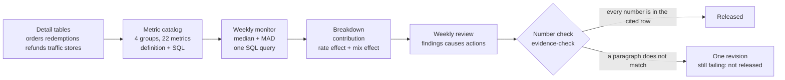

# Grounded Business Review

[中文](README.zh-CN.md)

Whoever reads the weekly business numbers has three questions to answer: which metrics moved, where the cause is, and what to do next. This project turns that into one reproducible pipeline on **synthetic local-services group-buying data** (vouchers bought online, redeemed in store):

**weekly monitoring → breakdown by dimension → weekly review → number check: a report that does not match the query results is not released**

It also measures three things: whether the cause is found; whether every number in the review traces back to a query result; and what letting the model decide what to query (an agent) gets right, and costs, compared with a fixed script and with a single prompt.

The data is generated by a script from random seeds. It is not any platform's business data, and the metric definitions are written for this data.

**Results on 36 known-answer test cases** (plan and file fingerprints fixed before the runs; model `claude-haiku-5-5`):

| | Script | One prompt | Agent |
|---|---|---|---|
| All planted causes found, nothing extra, nothing too coarse | 31/36 (86%) | 28/36 (78%) | **34/36 (94%)** |
| Reviews released after at most one revision | 36/36 | 35/36 | 33/36 |
| Released on the first draft | — | 19/36 | 12/36 |
| Cost per case (Batch API) | $0 | $0.0032 | $0.0057 |

The agent beat the one prompt case by case (6 to 0, p = 0.031); against the fixed script the gap (5 to 2) is too small to call. The one prompt missed all six causes that sit in a two-dimension cell such as "city × channel", because its fixed material breaks metrics down one dimension at a time. No review that was finally held back contained a wrong number: every failing paragraph failed on a Chinese number word. Details: [`eval/EVALUATION.md`](eval/EVALUATION.md).

## Four steps in one pipeline



1. **Metric catalog** ([`metrics/metrics.yaml`](metrics/metrics.yaml)): user growth, transaction efficiency, merchant operations and revenue health; 22 metrics, each with its definition, the dimensions it can be broken down by and the lower-level metrics that drive it. [`sql/metrics/`](sql/metrics/) computes them straight from the detail tables, and the offline tests check that both paths agree.
2. **Weekly monitor** ([`sql/monitor/weekly_alerts.sql`](sql/monitor/weekly_alerts.sql)): each week is compared with the 8 most recent non-holiday weeks using a modified Z-score (median and MAD) plus a minimum change. Totals and segments (city, category, channel, merchant type) are both checked.
3. **Breakdown** ([`bizagent/decompose.py`](bizagent/decompose.py), pure SQL versions in [`sql/analysis/`](sql/analysis/)): additive metrics get each segment's contribution; ratio metrics are split into "the segment's own rate changed" and "the segment's share changed", which add up exactly to the total change.
4. **Review and number check** ([`bizagent/evidence.py`](bizagent/evidence.py)): every query result is saved as a file. A paragraph with numbers must cite the row the numbers come from, and the [evidence-check](https://github.com/Jason-d-e/evidence-check) script checks each paragraph: the cited row must appear verbatim in the file, and every number in the paragraph must be in the cited row. One failing paragraph and the whole review is held back.

Formulas and rules come from published methods; sources are in [`docs/METHOD.md`](docs/METHOD.md) (in Chinese).

## Three approaches, the same cases

| Approach | Who decides what to query | Model calls |
|---|---|---|
| Script ([`baseline.py`](bizagent/baseline.py)) | Fixed rules: start from the strongest alert, follow the funnel to the first stage that changed, drill one level down | none |
| One prompt ([`arms.py`](bizagent/arms.py)) | A fixed set of query results goes to the model in one go | 1, plus 1 revision if the check fails |
| Agent ([`arms.py`](bizagent/arms.py)) | The model queries with four tools (overview, breakdown, segment check-up, SQL) | several, plus 1 revision if the check fails |

Every case has a known answer: each one is a randomly generated world with one event planted in one segment in one week (traffic, conversion, supply, redemption or refund), written into the case file when the case is made. Events the monitor cannot see are not used. Control cases: weeks with no event, a holiday week, the week after a holiday. Scoring uses rules only, no model grading. The plan was written before the runs: [`eval/PREREGISTRATION.md`](eval/PREREGISTRATION.md); results: [`eval/EVALUATION.md`](eval/EVALUATION.md).

The model is `claude-haiku-5-5`.

## What it produces

| Output | Where |
|---|---|
| A weekly review of week 37 written by the agent, with every query result and its SQL (in Chinese) | [run 1](reports/sample-agent-2026-W37-run1/report.md), [run 2](reports/sample-agent-2026-W37-run2/report.md) |
| Deep dive (in Chinese): did the redemption rate around holidays really change? | [`reports/专项分析_节假日前后的核销率.md`](reports/专项分析_节假日前后的核销率.md) |
| Excel weekly report: pick a week; overview, alert test, contributions, rate and mix effects are all recomputed by formulas | [`reports/经营周报_2026-W37.xlsx`](reports/经营周报_2026-W37.xlsx) |
| Charts: weekly trend, contribution, rate and mix effects | [`reports/`](reports/) |
| Platform version: the same pipeline as a Dify workflow | [`dify/`](dify/) |

Both reviews name the two planted causes (live-stream traffic down, customer-initiated refunds up in hair and nail salons), and neither was released: in run 1, 2 of 15 paragraphs failed ("两类", "本周一起"); in run 2, 1 of 12 failed ("上一日"). Each of these phrases contains a Chinese numeral that the check reads as a number missing from the cited row. The failing paragraphs are marked in the report.

The Excel formulas were recalculated in Excel and match the 108 values computed by SQL one by one (`python -m bizagent.cli excel --verify`).

### Dify version

The one-prompt pipeline is also built as a Dify workflow: pick a week → monitor and break down (code node) → write the review (model node) → number check (code node, the same evidence-check script) → released, or one revision and a second check. Try it online: [udify.app/workflow/V0B0GsRlxPm4SS56](https://udify.app/workflow/V0B0GsRlxPm4SS56) (the interface is in Chinese). Or import [`dify/weekly_review.yml`](dify/weekly_review.yml) into your own Dify; details and trial runs in [`dify/README.md`](dify/README.md).


## Run it yourself

Tested on Windows with Python 3.14; dependencies in `requirements.txt`.

```bash
pip install -r requirements.txt
python -m unittest discover -s tests          # offline tests, no model calls
python -m bizagent.cli demo                   # build the demo data and a script-written review
python -m bizagent.cli excel                  # the Excel weekly report
python -m bizagent.special                    # the deep dive
python -m bizagent.cli make-cases dev         # build the development cases
python -m bizagent.cli baseline dev           # run and score the script approach
```

For the model approaches, put a `.env` file in the project folder with one line, `ANTHROPIC_API_KEY=...`:

```bash
python -m bizagent.cli review --arm agent                      # the agent writes a review of the demo week
python -m bizagent.cli run agent dev --out my-run --batch      # evaluate on the development cases (Batch API, half price)
python -m bizagent.cli run agent dev --out my-run --batch --resume   # continue after an interruption without resubmitting
```

The number check on its own:

```bash
python -m bizagent.cli check report.json --evidence query-results-folder
```

A report is JSON with a `blocks` list; each block has `kind`, `text` and `evidence` (`source` is a file name, `quote` is a row copied verbatim). Exit code 1 means not released, with the problem listed for each paragraph.

## What the number check guarantees

It guarantees that every number in the review appears in the query-result row it cites: nothing invented, nothing copied from the wrong row.

It does not guarantee that the query asked the right question, or that the conclusion drawn from the numbers is right.

The check is strict and counts words that contain numbers: in Chinese, "两个渠道" (two channels) or "这三项" (these three) contain numbers, and they fail if the cited row does not have them. The writer has to rephrase without the number or cite a row that has it.

## Where it fits

One of a set of projects about making AI show its evidence: every statement points to its source, and every approach is evaluated before it is used.

- The check is [evidence-check](https://github.com/Jason-d-e/evidence-check), the same script, copied unchanged into `vendor/`. Elsewhere it checks policy clauses and document text; here it checks numbers in query results.
- The evaluation follows the same pattern as the other projects: answers fixed when the cases are made, the plan written before the runs, a comparison with simpler approaches, real costs recorded. The overview and evaluation cards are in [evidence-first](https://github.com/Jason-d-e/evidence-first).
- [grounded-labelling-pipeline](https://github.com/Jason-d-e/grounded-labelling-pipeline) has weekly metric reports and a staged rollout; [sellpoint-check](https://github.com/Jason-d-e/sellpoint-check) has another set of SQL analyses and a prototype of a group-buying store page.

## Related work

There is no new algorithm here, and this is not the first project to do this.

- Detecting metric changes automatically, breaking them down by dimension and explaining them in words is already done by merchant back offices and mainstream BI tools. What this project adds is the same pipeline on public synthetic data, with known-answer evaluation and a number check.
- Breakdown and segment selection: Adtributor (Bhagwan et al., NSDI 2014); rate and mix effects: Kitagawa 1955, Das Gupta 1993; synthetic data for multi-dimensional root-cause localisation: [RiskLoc](https://github.com/shaido987/riskloc), Squeeze.
- Modified Z-score for alerts: the NIST Engineering Statistics Handbook (Iglewicz and Hoaglin).
- [MetricLens](https://github.com/kennywu411-dev/metriclens) does metric attribution, number checking and a three-way comparison on retail transaction data; the "equivalent answer" rule in this scoring follows its evaluation design. [ShopPulse](https://github.com/UrianChen/ShopPulse) takes another route: the model writes sentences with placeholders and code fills in the numbers.
- Planting answers in synthetic data and then evaluating follows [InsightBench](https://github.com/ServiceNow/insight-bench).
- Field names in the metric catalog follow dbt MetricFlow and Lightdash.

## Limitations

- The data is synthetic. The kinds and sizes of events and the rules of all three approaches come from the same project; real business changes are messier, and causes are often outside the existing dimensions.
- The monitor does not remove trends; with a strong trend the baseline lags.
- Redemption and refund rates are "same-week" rates, so they move mechanically when payments move (that is what the deep dive is about).
- The number of cases is small; only large differences show.
- The quality of the recommended actions is not scored.

## License

MIT. The script in `vendor/evidence-check/` comes from evidence-check, also MIT.
