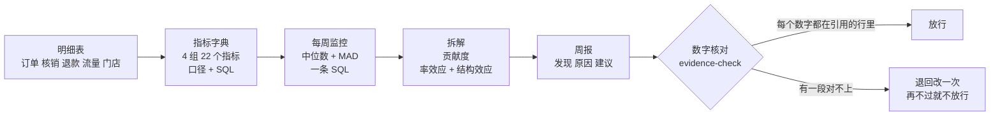

# 有据经营分析（Grounded Business Review）

[English](README.md)

每周看经营数据的人要回答三个问题：哪些指标异动了，原因在哪，下一步做什么。这个项目在一份**合成的到店团购数据**上，把这件事做成一条可以重跑的线：

**每周监控 → 按维度拆解 → 写经营周报 → 数字核对，对不上不放行**

并且量三件事：原因找得对不对；周报里的数字能不能都对回查询结果；让模型自己决定查什么，比固定脚本、比一次提示词，多做对了什么、多花了多少。

数据是脚本按随机种子生成的，不是任何平台的真实经营数据；指标口径是为这份数据拟的。

**36 道埋好答案的测试题上的结果**（计划和文件指纹在跑之前定好；模型 `claude-haiku-5-5`）：

| | 脚本 | 一次提示词 | Agent |
|---|---|---|---|
| 埋的原因全找对，不多报、不答粗 | 31/36（86%） | 28/36（78%） | **34/36（94%）** |
| 改一次以内放行 | 36/36 | 35/36 | 33/36 |
| 第一次交卷就放行 | — | 19/36 | 12/36 |
| 每题费用（批量接口） | 0 | 0.0032 美元 | 0.0057 美元 |

按题配对，Agent 比一次提示词多对 6 题、少对 0 题（p = 0.031）；和固定规则的脚本比是 5 比 2，题数太少，分不出高下。“城市 × 渠道”这类两个维度交叉的原因，一次提示词 6 题全错，因为交给它的固定材料只按单个维度拆。最后没放行的周报里没有一个数是错的，没过的段落都卡在中文数字上。详见 [`eval/EVALUATION.md`](eval/EVALUATION.md)（英文）。

## 一条线上的四步



1. **指标字典**（[`metrics/metrics.yaml`](metrics/metrics.yaml)）：用户增长、交易效率、商家运营、收入健康度四组，22 个指标，每个写明口径、能按哪些维度拆、由哪些下一层指标驱动。[`sql/metrics/`](sql/metrics/) 里有从明细表直接算的 SQL，自检会核对两边一致。
2. **每周监控**（[`sql/monitor/weekly_alerts.sql`](sql/monitor/weekly_alerts.sql)）：和前 8 个非节假日周比，用中位数和 MAD 算修正 Z 分数，再加最小变化幅度。总量和分组（城市、品类、渠道、商家类型）都查。
3. **拆解**（[`bizagent/decompose.py`](bizagent/decompose.py)，纯 SQL 版在 [`sql/analysis/`](sql/analysis/)）：加法指标算贡献度；比率指标拆成“这一组自己的率变了”和“这一组的占比变了”，两部分相加正好等于总变化。
4. **周报和数字核对**（[`bizagent/evidence.py`](bizagent/evidence.py)）：每次查询的结果存成一个文件。周报里带数字的段落必须引用数字所在的那一行，用 [evidence-check](https://github.com/Jason-d-e/evidence-check) 的脚本逐段核对：引用的行要一字不差地在文件里，段落里的每个数字要在引用的行里。有一段没过，整份不放行。

公式和规则都来自公开的做法，出处写在 [`docs/METHOD.md`](docs/METHOD.md)。

## 三种做法，同一批题

| 做法 | 谁决定查什么 | 调模型 |
|---|---|---|
| 脚本（[`baseline.py`](bizagent/baseline.py)） | 固定规则：从最强的异动开始，沿漏斗找第一个变了的环节，再往下钻一层 | 不调 |
| 一次提示词（[`arms.py`](bizagent/arms.py)） | 把一组固定的查询结果一次交给模型 | 1 次，核对没过再改 1 次 |
| Agent（[`arms.py`](bizagent/arms.py)） | 模型用四个工具（总览、拆解、分组体检、SQL）自己查 | 多轮，核对没过可以改 1 次 |

题目是埋好答案的：每道题在一个随机生成的世界里，往某一周的某个分组埋一个事件（流量、转化、供给、核销、退款五类），答案在出题时写定。监控看不见的事件不出题。另有对照题：没有事件的周、含节假日的周、节后的周。评分只用规则，不用模型打分。计划先写后跑：[`eval/PREREGISTRATION.md`](eval/PREREGISTRATION.md)，结果：[`eval/EVALUATION.md`](eval/EVALUATION.md)。

模型用 `claude-haiku-5-5`。

## 看得见的产出

| 产出 | 在哪 |
|---|---|
| 经营周报样例：Agent 写的第 37 周周报，附全部查询结果和 SQL | [第 1 次](reports/sample-agent-2026-W37-run1/report.md)、[第 2 次](reports/sample-agent-2026-W37-run2/report.md) |
| 专项分析：节假日前后的核销率是不是真的变了 | [`reports/专项分析_节假日前后的核销率.md`](reports/专项分析_节假日前后的核销率.md) |
| Excel 周报：选一周，总览、异动判定、贡献度、率效应和结构效应全部由公式重算 | [`reports/经营周报_2026-W37.xlsx`](reports/经营周报_2026-W37.xlsx) |
| 图：周趋势、贡献度、率效应和结构效应 | [`reports/`](reports/) |
| 平台版：同一条流程搭成 Dify 工作流 | [`dify/`](dify/) |

两份周报都找对了两个原因（直播渠道流量下降、美发美甲主动退款上升），也都没放行：第 1 次 15 段里 2 段没过（“两类”“本周一起”），第 2 次 12 段里 1 段没过（“上一日”）。这几处的中文数字被当成数字，引用的行里没有。没过的段落在报告里逐段标出。

Excel 里的公式用 Excel 实际重算过，和 SQL 算出的 108 个数逐个对上（`python -m bizagent.cli excel --verify`）。

### Dify 版

“一次提示词”这条流程也搭成了 Dify 工作流：选一周 → 监控和拆解（代码节点）→ 写周报（模型节点）→ 数字核对（代码节点，同一个 evidence-check 脚本）→ 放行；没过就改一次、再核对。在线试用：[udify.app/workflow/V0B0GsRlxPm4SS56](https://udify.app/workflow/V0B0GsRlxPm4SS56)。也可以导入 [`dify/weekly_review.yml`](dify/weekly_review.yml) 到自己的 Dify 里，节点说明和试跑记录见 [`dify/README.md`](dify/README.md)。


## 自己跑一遍

在 Windows、Python 3.14 上跑通；依赖见 `requirements.txt`。

```bash
pip install -r requirements.txt
python -m unittest discover -s tests          # 离线自检，不调模型
python -m bizagent.cli demo                   # 生成演示数据，出一份脚本版周报
python -m bizagent.cli excel                  # 出 Excel 周报
python -m bizagent.special                    # 出专项分析
python -m bizagent.cli make-cases dev         # 生成开发集的题
python -m bizagent.cli baseline dev           # 脚本做法跑一遍并评分
```

要跑模型做法，在项目文件夹里放一个 `.env`，写一行 `ANTHROPIC_API_KEY=...`：

```bash
python -m bizagent.cli review --arm agent                      # 让 Agent 写一份演示周的周报
python -m bizagent.cli run agent dev --out my-run --batch      # 在开发集上评测（走批量接口，半价）
python -m bizagent.cli run agent dev --out my-run --batch --resume   # 被打断后接着跑，不重复提交
```

单独用数字核对：

```bash
python -m bizagent.cli check 报告.json --evidence 查询结果文件夹
```

报告是一个带 `blocks` 列表的 JSON，每段有 `kind`、`text` 和 `evidence`（`source` 是文件名，`quote` 是原样复制的一行）。退出码 1 表示没放行，并列出每一段的问题。

## 数字核对能保证什么

能保证：周报里的每个数字都出现在它引用的那一行查询结果里，没有编的、抄错行的。

不能保证：查询本身问对了问题；从数字得出的结论是对的。

核对很严，计数词也算数字：“两个渠道”“这三项”里的数，引用的行里没有就过不了。写的人要把它换成不带数的说法，或者引用写着这个数的那一行。

## 在整套项目里的位置

这是“让 AI 拿出证据”这组项目里的一个：每一句话能指到出处，每个做法上线前先拿出评测。

- 核对用的是 [evidence-check](https://github.com/Jason-d-e/evidence-check)，同一个脚本，原样放在 `vendor/`。在别的项目里它核对的是政策条款和文档原文，这里核对的是查询结果里的数字。
- 评测的做法和其他项目一样：答案在出题时定好，计划先写后跑，和更简单的做法比，费用照实记。总表和评测卡在 [evidence-first](https://github.com/Jason-d-e/evidence-first)。
- [grounded-labelling-pipeline](https://github.com/Jason-d-e/grounded-labelling-pipeline) 里有每周的指标报告和灰度上线；[sellpoint-check](https://github.com/Jason-d-e/sellpoint-check) 里有另一组 SQL 分析和团购门店页的原型。

## 相关工作

这里没有新的算法，也不是第一个做这件事的。

- 自动发现异动、按维度拆解、用文字解释，商家后台和主流 BI 工具已经在做。这个项目做的是把同一条流程放在公开的合成数据上，配上已知答案的评测和数字核对。
- 拆解和选分组：Adtributor（Bhagwan 等，NSDI 2014）；比率的率效应和结构效应：Kitagawa 1955、Das Gupta 1993；多维根因定位的合成数据做法：[RiskLoc](https://github.com/shaido987/riskloc)、Squeeze。
- 异动判定的修正 Z 分数：NIST 工程统计手册（Iglewicz 和 Hoaglin）。
- [MetricLens](https://github.com/kennywu411-dev/metriclens) 在零售交易数据上做了指标归因、数字核对和三种做法的对比，这里评分时的“等价答案”规则参照了它的评测方案。[ShopPulse](https://github.com/UrianChen/ShopPulse) 用的是另一种思路：模型只写带占位符的句子，数字由程序填。
- 用合成数据埋答案再评测的组织方式参照 [InsightBench](https://github.com/ServiceNow/insight-bench)。
- 指标字典的字段名参照 dbt MetricFlow 和 Lightdash。

## 局限

- 数据是合成的。事件的种类、幅度和三种做法的规则出自同一个项目，真实业务里的异动更杂，原因也常常不在已有的维度里。
- 监控规则没有去趋势，指标有明显趋势时基线会落后。
- 核销率、退款率用的是“当周口径”，支付量一变它们就机械地跟着变（专项分析写的就是这件事）。
- 评测题数不多，只能看出大的差别。
- 建议的好坏没有评分。

## 许可

MIT。`vendor/evidence-check/` 下的脚本来自 evidence-check，同为 MIT。
