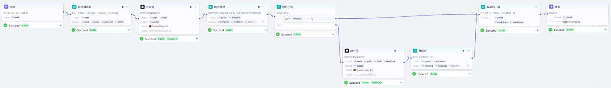

# 扣子开源版（Coze Studio）

同一条流程搭在扣子开源版 [Coze Studio](https://github.com/coze-dev/coze-studio) 的工作流里，跑在本机：选一周 → 监控和拆解 → 写周报 → 数字核对 → 放行；没过就改一次、再核对，最后一版标明放行了没有。节点、代码和提示词和 [Dify 版](../dify/) 是同一份。



## 试跑记录

2026-11-17 在本机的 Coze Studio 上跑，模型 `claude-haiku-5-5`（和本地评测同一个模型）。只为确认流程在平台上跑得通，不是评测；评测见 [`eval/`](../eval/)。

| 周 | 埋的原因 | 周报给的原因 | 核对 |
|---|---|---|---|
| 第 37 周 | 直播渠道流量下降；美发美甲退款上升 | 两个都找到，没有多报 | 第一稿放行（14 段含数字或引用，全部通过） |
| 第 36 周 | 无 | 无异动 | 跑了 3 次：2 次改一次后放行，1 次改一次后仍有 1 段没过 |
| 第 40 周 | 国庆假期 | 节假日，没有多报 | 改一次后仍有 1 段没过，未放行 |
| 第 35 周 | 上海的短视频流量下降 | 上海流量下降（比埋的粗一层） | 第一稿放行（6 段全部通过） |

一次运行 15 到 75 秒；“写周报”节点读入约 6 千到 2 万 token，写出约 1 千到 1.3 万 token（含模型自己的思考）。

搭的过程中碰到三处平台上的差别，都改在生成脚本里：

- 模型节点不能带 `temperature`：Claude Haiku 5.5 会直接拒绝这个参数。
- 模型管理页的“Thinking Type: Disable”没有传到模型那边。没传时模型默认先思考，原来 8192 的输出上限被思考用完，周报是空的；同样的请求明确关掉思考时，只写出约 2500 token 就结束。所以把输出上限调到 20000（再高，平台用的 Anthropic Go 库会要求改成流式调用）。
- “变量聚合”节点取列表里第一个有值的变量，而第一次核对一定有输出，所以把“再核对”排在前面：改过就取改过的那版，没改过就取第一版。第 36、40 周第一次跑时还是旧顺序，结果页显示的是没改之前的那版，改正后重跑，上表是改正后的结果。

## 在本机跑起来

要先装好 Docker Desktop（Windows 上用 WSL 2）。

```bash
git clone --depth 1 https://github.com/coze-dev/coze-studio.git
cd coze-studio
cp docker/.env.example docker/.env
echo 'export CODE_RUNNER_TYPE="local"' >> docker/.env
# 把本仓库的三份文件放进 coze-studio：
#   coze/compose.minio-fix.yml       -> docker/compose.minio-fix.yml
#   coze/compose.bizreview-data.yml  -> docker/compose.bizreview-data.yml
#   dify/data/*.json                 -> docker/volumes/bizreview-data/
docker compose -f ./docker/docker-compose.yml -f ./docker/compose.minio-fix.yml -f ./docker/compose.bizreview-data.yml up -d
```

然后打开 `http://localhost:8888`，注册一个本机账号；在 `http://localhost:8888/admin/#model-management` 加一个模型（这里用的是 Claude：protocol `claude`，base_url `https://api.anthropic.com`（不带 `/v1`，它会自己加），模型 `claude-haiku-5-5`）。

和官方默认做法不同的三处：

| 改了什么 | 为什么 |
|---|---|
| 文件存储 MinIO 换成同一版本的 `bitnamilegacy/minio:2025.6.13`（[`compose.minio-fix.yml`](compose.minio-fix.yml)） | 官方配置里的 `minio/minio` 镜像在 Docker Hub 上已经拉不到，整个启动会失败 |
| 代码节点改成在服务容器里直接运行（`CODE_RUNNER_TYPE="local"`） | 默认的沙箱模式经一个管道一次写入代码和输入，超过约 64 KB 就会卡住，而数字核对节点光代码就有 36 KB |
| 四个场景周的数据挂进服务容器（[`compose.bizreview-data.yml`](compose.bizreview-data.yml)） | 直接运行模式下，代码和输入经命令行参数传，单个参数上限 128 KB；周数据有 430 KB，所以由“监控和拆解”节点自己从挂进来的文件夹读，读不到才去下载 |

## 放进工作流

工作流由脚本生成：

```bash
python -m bizagent.coze_canvas --model-id <模型管理里的编号> --model-name claude-haiku-5-5
```

得到 [`weekly_review_canvas.json`](weekly_review_canvas.json)，用页面自己的接口（`/api/workflow_api/create`、`/api/workflow_api/save`）放进一个新工作流，再在编辑页上试运行。

| 节点 | 做什么 |
|---|---|
| 开始 | 输入要看的周：37、36、40 或 35 |
| 监控和拆解（代码） | 读这一周和前 12 周的指标，判定异动，按城市、品类、渠道、商家类型拆解，给异动分组做体检，输出编号的查询结果 q01、q02…… |
| 写周报（大模型） | 读查询结果，写带引用的 JSON 周报 |
| 数字核对（代码） | evidence-check 0.4.0 的脚本原文加一段包装：每段引用的行要在查询结果里，段里的数字要在引用的行里 |
| 放行了吗（选择器） | 全部通过就去“取最后一版”，否则去“改一次” |
| 改一次（大模型）、再核对（代码） | 把没过的段和原因交回去改，再核对一次 |
| 取最后一版（变量聚合）、结束 | 输出 Markdown 周报，开头写明放行了没有 |
