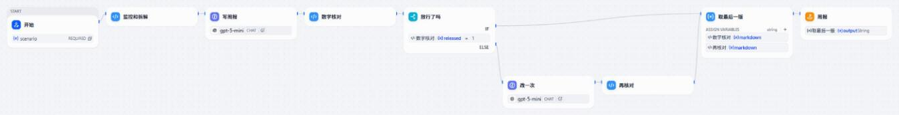
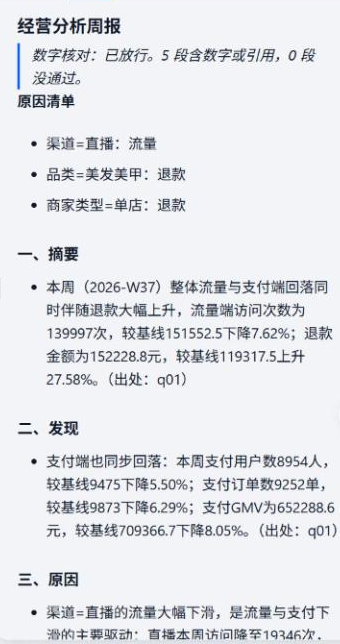

# Dify 版

同一条流程搭在 Dify 的工作流里：选一周 → 监控和拆解 → 写周报 → 数字核对 → 放行。没过核对就改一次、再核对一次，最后一版标明放行了没有。

在线试用：[udify.app/workflow/V0B0GsRlxPm4SS56](https://udify.app/workflow/V0B0GsRlxPm4SS56)（选一周，点“运行”，一次大约一分钟）。



## 导入

1. Dify 里点“工作室 → 创建 → 导入应用”，选 [`weekly_review.yml`](weekly_review.yml)。
2. 两个模型节点默认用 `gpt-5-mini`（Dify Cloud 自带额度里的模型），可以换成工作区里配好的任何聊天模型。
3. 点“运行”，选一周。

## 节点

| 节点 | 做什么 | 来源 |
|---|---|---|
| 监控和拆解（代码） | 用这一周和前 12 周的指标算异动，按城市、品类、渠道、商家类型拆解，给异动分组做体检，输出编号的查询结果 q01、q02…… | [`node_monitor.py`](node_monitor.py)，只用 Python 标准库；规则同 [`weekly_alerts.sql`](../sql/monitor/weekly_alerts.sql) 和 [`decompose.py`](../bizagent/decompose.py)，四个场景的报警数和 SQL 一致 |
| 写周报（模型） | 读查询结果，写带引用的 JSON 周报 | [`prompt_system.md`](prompt_system.md)：和本地“一次提示词”做法同一份规则，加上输出格式 |
| 数字核对（代码） | 每段引用的行要原样在查询结果里，段里的每个数字要在引用的行里 | [`node_check.py`](node_check.py) = evidence-check 0.4.0 的脚本原文 + [`check_tail.py`](check_tail.py) |
| 放行了吗（条件） | 全部通过就去“取最后一版”，否则去“改一次” | |
| 改一次（模型）、再核对（代码） | 把没过的段和原因交回去改，再核对一次 | [`prompt_revise.md`](prompt_revise.md) |
| 取最后一版、周报 | 输出 Markdown 周报，开头写明放行没有，没过的段落逐段标出 | |

## 数据

四个场景周的数据是合成的，压缩后放在“监控和拆解”节点里，应用不依赖外部数据源。原文件在 [`data/`](data/)。

```bash
python -m bizagent.dify_export   # 重新导出四个场景，核对节点报警数和 SQL 一致，出核对节点和提示词
python -m bizagent.dify_dsl      # 重新生成 weekly_review.yml
```

## 试跑记录

2026-11-17 在 Dify Cloud 上跑，模型 `gpt-5-mini`。只为确认流程在平台上跑得通，不是评测；评测在本地用 `claude-haiku-5-5` 跑，见 [`eval/`](../eval/)。

| 周 | 埋的原因 | 周报给的原因 | 核对 |
|---|---|---|---|
| 第 37 周 | 直播渠道流量下降；美发美甲退款上升 | 两个都找到；另多报“商家类型=单店：退款” | 第一次交卷放行 |
| 第 36 周 | 无 | 无异动 | 放行 |
| 第 40 周 | 国庆假期 | 节假日；另多报“品类=烧烤：核销” | 放行 |
| 第 35 周 | 上海的短视频流量下降 | 上海流量下降（比埋的粗一层）；另多报“上海：转化” | 放行 |

第 37 周之前还跑过一次：改了一次以后仍有两段没过，周报标为未放行。没过的是“发现二”“原因二”里的“二”，核对把它当成数字 2。之后在输出格式里写明段落不要编号，核对的反馈也会指出是哪个中文数字，上表第 37 周是改完以后的结果；第 35、36、40 周是改之前跑的。

上表第 37 周那次的结果页（开头一行写明放行了没有，下面是原因清单和各段）：


