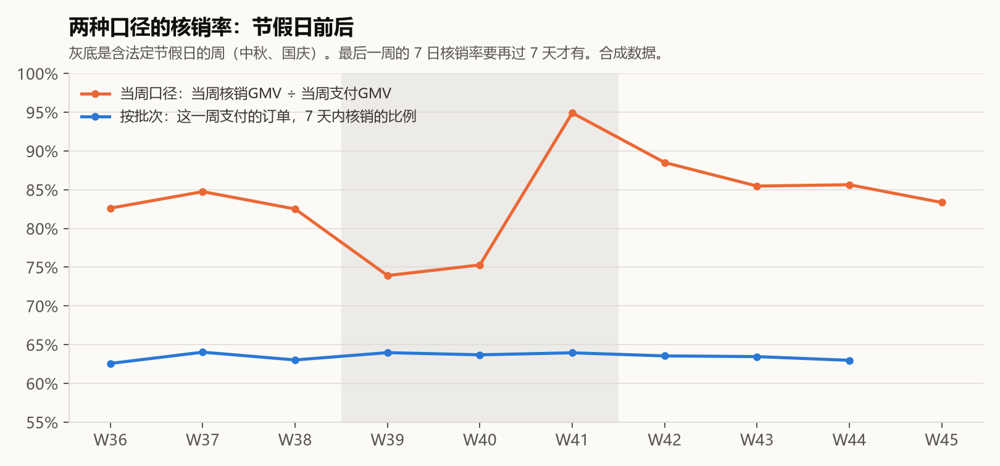

# 专项分析：节假日前后的核销率（2026-W36 至 2026-W45）

> 数字核对：已放行。8 段含数字或引用，8 段核对通过，0 段没通过。



## 一、摘要

- 问题：监控里的核销率在中秋和国庆那几周大幅下降，节后又冲高，退款率在节后也触发了异动。这是核销和退款真的出了问题，还是口径造成的？
- 结论：是口径造成的。当周口径的核销率从 2026-W38 的 82.51% 掉到 2026-W39 的 73.92%，又在 2026-W41 升到 94.91%；同样这几周支付的订单，7 日核销率分别是 63.03%、63.97%、63.95%，几乎没有变。（出处：q01、q02）

## 二、发现

- 节假日周支付放量，分母变大。支付GMV 从 2026-W38 的 736,687.9 元升到 2026-W40 的 990,475.1 元；同期核销GMV 从 607,871.3 元升到 745,767.7 元，涨得慢，因为节日里买的券有一部分要过几天才用。当周核销率于是从 82.51% 落到 75.29%。（出处：q01）
- 节后支付回落，节日里买的券集中到店，分子反而更大。2026-W41 的支付GMV 回到 842,352 元，核销GMV 却升到 799,472 元，当周核销率升到 94.91%，高于 2026-W40 的 75.29%。（出处：q01）
- 固定一批订单往后看，核销没有变化。2026-W38、2026-W39、2026-W40、2026-W41 支付的订单，7 日核销率是 63.03%、63.97%、63.69%、63.95%；30 日核销率在已经走完观察期的 2026-W38、2026-W39、2026-W40 是 82.44%、83.6%、83.33%。（出处：q02）
- 节后的退款率偏高，是节日订单到期带来的。当周退款率从 2026-W38 的 17.14% 升到 2026-W45 的 20.07%。过期退的金额从 2026-W38 的 62,453.6 元升到 2026-W45 的 77,719 元；2026-W45 的过期退里，节假日周支付的订单占 77,719 元。（出处：q01、q03）
- 按批次看，最终退款率同样稳定：2026-W38、2026-W39、2026-W40 支付的订单，最终退款率是 17.56%、16.4%、16.67%。（出处：q02）

## 三、原因

- 原因在口径：当周核销率、当周退款率的分子和分母不是同一批订单。分母是当周支付的订单，分子里有大量前几周支付的订单。支付量一波动，这两个率就跟着反向摆动，和核销、退款本身的好坏无关。（出处：q01、q02）

## 四、建议

- 周监控里，把按批次的 7 日核销率设为判断核销是否健康的主指标；当周核销率只用来对账，不单独报异动。（出处：q02）
- 节假日周和节后的几周，当周核销率、当周退款率的异动先标成“节假日余波”，再看按批次的口径有没有同步变化；同步变了才升级处理。
- 给商家看的周报同样处理：节后核销冲高不写成“核销改善”，节后退款偏高不写成“退款恶化”，避免商家据此误调券的有效期或库存。

## 五、说明

- 局限：按批次的口径要等观察期走完才有数，最新的那一周还没有按批次的核销率；它回答的是“这批券用掉多少”，不能替代当周的现金流口径。数据是合成的，没有埋任何事件。

## 附：查询结果

<details><summary>q01 当周口径的支付、核销、退款（按周）</summary>

数据范围：2026-W36 至 2026-W45，其中 2026-W39 含中秋，2026-W40、2026-W41 含国庆。
当周核销率 = 当周核销GMV ÷ 当周支付GMV；当周退款率 = 当周退款金额 ÷ 当周支付GMV。

| 周 | 支付GMV_元 | 核销GMV_元 | 当周核销率_pct | 退款金额_元 | 当周退款率_pct |
|---|---|---|---|---|---|
| 2026-W36 | 746985.9 | 617178.7 | 82.62 | 124216.1 | 16.63 |
| 2026-W37 | 713493.5 | 604665.6 | 84.75 | 120550 | 16.9 |
| 2026-W38 | 736687.9 | 607871.3 | 82.51 | 126269.6 | 17.14 |
| 2026-W39 | 872361.6 | 644865.8 | 73.92 | 121659.5 | 13.95 |
| 2026-W40 | 990475.1 | 745767.7 | 75.29 | 129851.2 | 13.11 |
| 2026-W41 | 842352 | 799472 | 94.91 | 133495.4 | 15.85 |
| 2026-W42 | 736282 | 651701.4 | 88.51 | 137568.1 | 18.68 |
| 2026-W43 | 731752.9 | 625412.5 | 85.47 | 133205.6 | 18.2 |
| 2026-W44 | 729303 | 624580.7 | 85.64 | 136131.6 | 18.67 |
| 2026-W45 | 742854 | 619177.5 | 83.35 | 149120.1 | 20.07 |

SQL：
```sql
SELECT week_id AS 周,
       ROUND(MAX(value) FILTER (WHERE metric = 'gmv'), 2)         AS 支付GMV_元,
       ROUND(MAX(value) FILTER (WHERE metric = 'redeem_gmv'), 2)  AS 核销GMV_元,
       ROUND(MAX(value) FILTER (WHERE metric = 'redeem_rate'), 2) AS 当周核销率_pct,
       ROUND(MAX(value) FILTER (WHERE metric = 'refund_amt'), 2)  AS 退款金额_元,
       ROUND(MAX(value) FILTER (WHERE metric = 'refund_rate'), 2) AS 当周退款率_pct
FROM metric_weekly
WHERE dim = 'total' AND week_id >= '2026-W36'
GROUP BY week_id
ORDER BY week_id
```

</details>

<details><summary>q02 按支付周分批的核销率和退款率</summary>

数据范围：2026-W36 至 2026-W45，其中 2026-W39 含中秋，2026-W40、2026-W41 含国庆。
7 日核销率：这一周支付的订单里，支付后 7 天内核销的金额占比；30 日核销率同理，看支付后 30 天内。最终退款率：这批订单最后退掉的金额占比。

| 支付周 | 订单数 | 支付GMV_元 | 七日核销率_pct | 三十日核销率_pct | 最终退款率_pct | 核销间隔中位数_天 |
|---|---|---|---|---|---|---|
| 2026-W36 | 10496 | 746985.9 | 62.58 | 83.46 | 16.54 | 2 |
| 2026-W37 | 10213 | 713493.5 | 64.03 | 83.44 | 16.56 | 2 |
| 2026-W38 | 10301 | 736687.9 | 63.03 | 82.44 | 17.56 | 2 |
| 2026-W39 | 12325 | 872361.6 | 63.97 | 83.6 | 16.4 | 2 |
| 2026-W40 | 13795 | 990475.1 | 63.69 | 83.33 | 16.67 | 2 |
| 2026-W41 | 11814 | 842352 | 63.95 |  |  | 2 |
| 2026-W42 | 10293 | 736282 | 63.55 |  |  | 2 |
| 2026-W43 | 10367 | 731752.9 | 63.46 |  |  | 2 |
| 2026-W44 | 10456 | 729303 | 62.98 |  |  | 2 |
| 2026-W45 | 10602 | 742854 |  |  |  | 1 |

SQL：
```sql
SELECT pay_week AS 支付周, orders AS 订单数, gmv AS 支付GMV_元,
       redeem_rate_7d AS 七日核销率_pct, redeem_rate_30d AS 三十日核销率_pct,
       refund_rate_final AS 最终退款率_pct, median_days_to_redeem AS 核销间隔中位数_天
FROM (-- 同一批订单的核销情况：按支付周分批，看这批订单支付后 7 天内、30 天内核销了多少，最终退了多少。
--
-- 为什么要有这张表：监控用的核销率是当周核销GMV ÷ 当周支付GMV，分子分母不是同一批订单，
-- 支付放量的那一周它会被拉低。这里固定一批订单往后看，回答的是“这批券到底用掉了多少”。
-- 只有观察期已经走完的批次才有数（7 日核销率要等这一周结束后再过 7 天）。
WITH last_day AS (
    SELECT MAX(date) AS d FROM dim_date
),
orders AS (
    SELECT o.order_id, o.order_amount, o.pay_date, d.week_id AS pay_week, w.week_end,
           r.redeem_date, f.refund_date
    FROM fact_order o
    JOIN dim_date d ON d.date = o.pay_date
    JOIN dim_week w ON w.week_id = d.week_id
    LEFT JOIN fact_redeem r ON r.order_id = o.order_id
    LEFT JOIN fact_refund f ON f.order_id = o.order_id
    WHERE w.in_report
),
cohort AS (
    SELECT pay_week,
           ANY_VALUE(week_end)                                                   AS week_end,
           COUNT(*)                                                              AS orders,
           SUM(order_amount)                                                     AS gmv,
           SUM(order_amount) FILTER (WHERE redeem_date <= pay_date + 7)          AS redeemed_7d,
           SUM(order_amount) FILTER (WHERE redeem_date <= pay_date + 30)         AS redeemed_30d,
           SUM(order_amount) FILTER (WHERE refund_date IS NOT NULL)              AS refunded,
           MEDIAN(redeem_date - pay_date) FILTER (WHERE redeem_date IS NOT NULL) AS median_days_to_redeem
    FROM orders
    GROUP BY pay_week
)
SELECT c.pay_week,
       c.orders,
       ROUND(c.gmv, 2) AS gmv,
       CASE WHEN c.week_end + 7  <= l.d THEN ROUND(100.0 * c.redeemed_7d  / c.gmv, 2) END AS redeem_rate_7d,
       CASE WHEN c.week_end + 30 <= l.d THEN ROUND(100.0 * c.redeemed_30d / c.gmv, 2) END AS redeem_rate_30d,
       CASE WHEN c.week_end + 31 <= l.d THEN ROUND(100.0 * c.refunded     / c.gmv, 2) END AS refund_rate_final,
       c.median_days_to_redeem,
       -- 和上一批比：7 日核销率变了多少个百分点
       CASE WHEN c.week_end + 7 <= l.d
            THEN ROUND(100.0 * c.redeemed_7d / c.gmv
                       - LAG(100.0 * c.redeemed_7d / c.gmv) OVER (ORDER BY c.pay_week), 2) END AS redeem_rate_7d_change
FROM cohort c
CROSS JOIN last_day l
ORDER BY c.pay_week)
WHERE pay_week >= '2026-W36'
ORDER BY pay_week
```

</details>

<details><summary>q03 节前和节后的退款，按退款类型，以及其中来自节假日周订单的部分</summary>

数据范围：2026-W36 至 2026-W45，其中 2026-W39 含中秋，2026-W40、2026-W41 含国庆。

| 退款周 | 退款类型 | 退款金额_元 | 其中节假日周支付的订单_元 |
|---|---|---|---|
| 2026-W38 | 主动退 | 63816 |  |
| 2026-W38 | 过期退 | 62453.6 |  |
| 2026-W44 | 主动退 | 67888 | 24053.5 |
| 2026-W44 | 过期退 | 68243.6 | 68243.6 |
| 2026-W45 | 主动退 | 71401.1 | 3862 |
| 2026-W45 | 过期退 | 77719 | 77719 |

SQL：
```sql
SELECT d.week_id AS 退款周, f.refund_type AS 退款类型,
       ROUND(SUM(f.refund_amount), 2) AS 退款金额_元,
       ROUND(SUM(f.refund_amount) FILTER (WHERE p.is_holiday_week), 2) AS 其中节假日周支付的订单_元
FROM fact_refund f
JOIN dim_date d ON d.date = f.refund_date
JOIN fact_order o ON o.order_id = f.order_id
JOIN dim_date pd ON pd.date = o.pay_date
JOIN dim_week p ON p.week_id = pd.week_id
WHERE d.week_id IN ('2026-W38', '2026-W44', '2026-W45')
GROUP BY d.week_id, f.refund_type
ORDER BY d.week_id, f.refund_type
```

</details>
